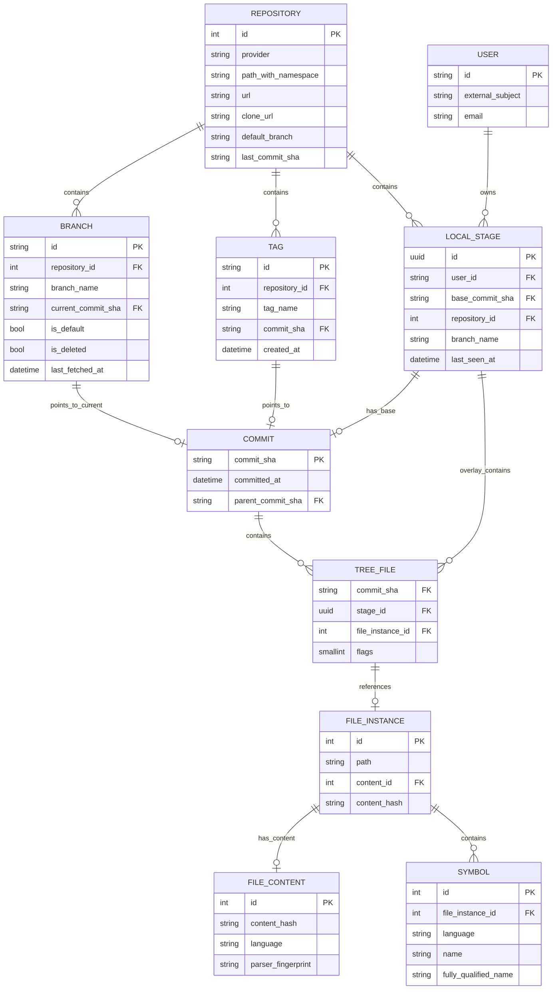
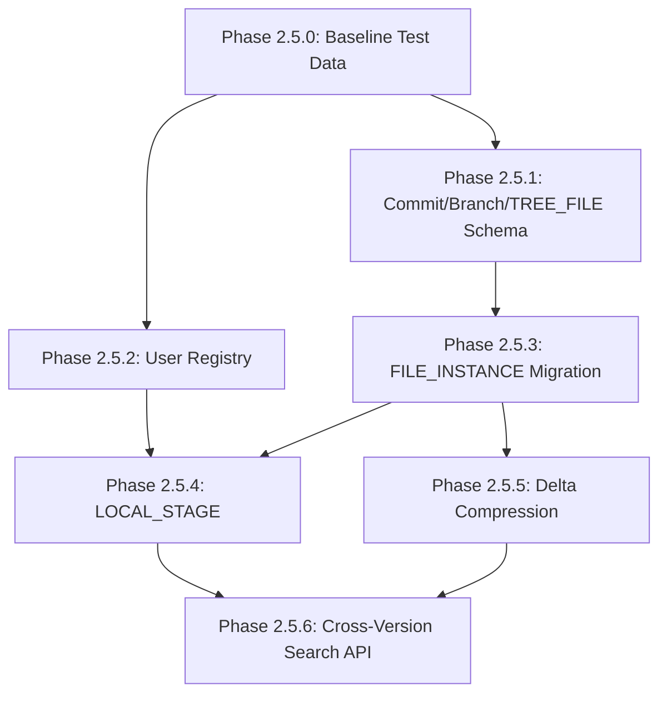

# Multi-Branch and Multi-Developer Tracking Implementation Plan

**Status**: `🚧` In progress (2.5.0 done, 2.5.1 partial)  
**Created**: 2026-03-22  
**Updated**: 2026-10-14  
**Baseline**: [`plans/multi_branch_brainstorm_baseline.md`](../../../plans/multi_branch_brainstorm_baseline.md)

## Overview

This document outlines the implementation plan for multi-branch indexing and multi-developer collaboration features based on the approved data model from the brainstorming sessions.

### Implementation Principles

> **IMPORTANT**: This plan follows an interactive, approval-driven approach:

1. **Algorithms are not fixed** - All code examples in this document are reference implementations, not final solutions. Each algorithm must be discussed and tuned at implementation time for optimal performance.

2. **Approval required for algorithms** - Before implementing any algorithm (especially delta conversion, resolution queries, migration scripts), the exact approach must be presented and approved.

3. **Performance tuning is iterative** - Database operations will be benchmarked and optimized based on actual data characteristics.

4. **Consult expertise** - Complex operations (particularly delta transformation) require careful ordering of actions to avoid wasted resources. These will be designed collaboratively.

### Key Design Decisions (Approved)

| Decision | Choice |
|----------|--------|
| Core model | COMMIT + LOCAL_STAGE as tree roots (no INDEX_TREE table) |
| COMMIT identity | commit_sha as primary key (globally unique, cross-repo sharing) |
| FILE_INSTANCE | Immutable, referenced via TREE_FILE junction |
| TREE_FILE | Optimized - removed path, added flags field, nullable FKs |
| LOCAL_STAGE | Commit-based, client-generated UUID, informational repo/branch |
| Delta compression | Eager conversion, first-match-wins resolution |
| Delta type inference | parent_commit_sha=NULL → snapshot; set → delta |

## Target Schema



## Phase Breakdown

### Phase 2.5.0: Baseline Test Data Preparation

**Goal**: Create reference data set for migration testing before any schema changes.

**Rationale**: We need real data to validate that the migration works correctly and to benchmark query performance before/after changes.

**Implementation Steps**:
1. **Select test repositories** - Choose 2-3 repositories with different characteristics:
   - Small repo (< 100 files) for quick iteration
   - Medium repo (100-1000 files) for typical use case
   - Large repo (> 1000 files) for stress testing

2. **Index with current code** - Run full indexing using the current schema:
   - Record timing metrics for each phase
   - Note final row counts in each table
   - Capture sample queries and their execution plans

3. **Create database snapshot** - Dump the test database:
   ```bash
   pg_dump -Fc indexer_test > baseline_test_data.dump
   ```

4. **Document baseline metrics**:
   - Row counts per table
   - Index sizes
   - Sample query execution times
   - Storage requirements

**Validation**:
- Test repositories fully indexed with current code
- Baseline metrics documented
- Database snapshot saved for repeatable migration testing

**Status**: `✅` Completed 2026-03-23. See [`phase_2.5.0_completion_summary.md`](../validation/phase_2.5.0_completion_summary.md).

---

### Phase 2.5.1: Commit, Branch, Tag and TREE_FILE Schema

**Status**: `🚧` Schema, migration and backfill landed in `6388af6` (2026-09-30); repository sync does not write these tables yet.

**Detailed design**: [`phase_2.5.1_technical_design.md`](./phase_2.5.1_technical_design.md)

**As implemented** (migration `a1b2c3d4e5f1_add_git_tracking_tables.py`, models in `src/database/models/git_tracking.py`):
- Table is named `git_commits` (not `commits`) and keeps a nullable `repository_id`.
- `tree_files` was created in this phase (pulled forward from 2.5.3) and backfilled from existing `file_instances`.
- One `branches` row per repository default branch is backfilled.
- Open: sync-path writes for commits/branches/tags (implementation steps 3-4 below).

**Goal**: Add COMMIT and BRANCH tables for branch-aware indexing.

**Schema Changes**:
```sql
-- Commit table (repository-agnostic)
CREATE TABLE commits (
    commit_sha VARCHAR(40) PRIMARY KEY,
    committed_at TIMESTAMPTZ NOT NULL,
    parent_commit_sha VARCHAR(40) REFERENCES commits(commit_sha)
);

CREATE INDEX idx_commits_parent ON commits(parent_commit_sha) WHERE parent_commit_sha IS NOT NULL;

-- Branch table
CREATE TABLE branches (
    id VARCHAR(255) PRIMARY KEY,  -- provider:repo:branch
    repository_id INTEGER NOT NULL REFERENCES repositories(id) ON DELETE CASCADE,
    branch_name VARCHAR(500) NOT NULL,
    current_commit_sha VARCHAR(40) NOT NULL REFERENCES commits(commit_sha),
    is_default BOOLEAN DEFAULT FALSE,
    is_deleted BOOLEAN DEFAULT FALSE,
    last_fetched_at TIMESTAMPTZ,
    UNIQUE(repository_id, branch_name)
);

CREATE INDEX idx_branches_repo ON branches(repository_id);
CREATE INDEX idx_branches_commit ON branches(current_commit_sha);

-- Tag table
CREATE TABLE tags (
    id VARCHAR(255) PRIMARY KEY,  -- provider:repo:tag
    repository_id INTEGER NOT NULL REFERENCES repositories(id) ON DELETE CASCADE,
    tag_name VARCHAR(500) NOT NULL,
    commit_sha VARCHAR(40) NOT NULL REFERENCES commits(commit_sha),
    created_at TIMESTAMPTZ DEFAULT NOW(),
    UNIQUE(repository_id, tag_name)
);

CREATE INDEX idx_tags_repo ON tags(repository_id);
CREATE INDEX idx_tags_commit ON tags(commit_sha);
```

**Implementation Steps**:
1. Create `Commit`, `Branch`, `Tag` SQLAlchemy models
2. Create Alembic migration
3. Update repository sync to create COMMIT and BRANCH records
4. Add branch discovery logic (git ls-remote or provider API)

**Validation**:
- Commits created on sync with correct parent linkage
- Branches point to current commit
- Tags point to specific commits

---

### Phase 2.5.2: User Registry Foundation

**Status**: `🧭` Planned. No `users` table yet.

**Goal**: Store user identities for LOCAL_STAGE ownership.

**Schema Changes**:
```sql
CREATE TABLE users (
    id VARCHAR(255) PRIMARY KEY,  -- Keycloak subject ID
    external_subject VARCHAR(255) UNIQUE NOT NULL,
    email VARCHAR(255),
    created_at TIMESTAMPTZ DEFAULT NOW(),
    updated_at TIMESTAMPTZ DEFAULT NOW()
);

CREATE INDEX idx_users_external_subject ON users(external_subject);
CREATE INDEX idx_users_email ON users(email);
```

**Implementation Steps**:
1. Create `User` SQLAlchemy model in the [`src/database/models/`](../../src/database/models/) package
2. Create Alembic migration for `users` table
3. Add user sync logic in Keycloak auth flow
4. Add user management API endpoints (optional, for admin use)

**Validation**:
- User record created on first Keycloak login
- User records queryable by `external_subject` and `email`

---

### Phase 2.5.3: TREE_FILE Junction and FILE_INSTANCE Migration

**Status**: `🧭` `tree_files` table and backfill already exist (Phase 2.5.1); remaining work is dropping legacy columns and switching queries to the TREE_FILE join.

**Goal**: Replace direct FILE_INSTANCE → repository relationship with TREE_FILE junction.

> ⚠️ **MIGRATION ALGORITHM DESIGN REQUIRED**: The data migration strategy needs careful design to ensure zero data loss and minimal downtime. The exact migration script must be reviewed and approved before execution.

**Schema Changes**:
```sql
-- TREE_FILE junction table
CREATE TABLE tree_files (
    commit_sha VARCHAR(40) REFERENCES commits(commit_sha),
    stage_id UUID REFERENCES local_stages(id),
    file_instance_id INTEGER NOT NULL REFERENCES file_instances(id) ON DELETE CASCADE,
    flags SMALLINT DEFAULT 0,
    PRIMARY KEY (commit_sha, stage_id, file_instance_id),
    CHECK (
        (commit_sha IS NOT NULL AND stage_id IS NULL) OR
        (commit_sha IS NULL AND stage_id IS NOT NULL)
    )
);

CREATE INDEX idx_tree_files_instance ON tree_files(file_instance_id);
CREATE INDEX idx_tree_files_commit ON tree_files(commit_sha) WHERE commit_sha IS NOT NULL;
CREATE INDEX idx_tree_files_stage ON tree_files(stage_id) WHERE stage_id IS NOT NULL;

-- Remove old columns from FILE_INSTANCE
ALTER TABLE file_instances DROP COLUMN repository_id;
ALTER TABLE file_instances DROP COLUMN commit_id;

-- Remove old column from SYMBOL
ALTER TABLE symbols DROP COLUMN commit_id;
```

**Migration Strategy** (REFERENCE ONLY - to be designed):
1. Create TREE_FILE table
2. Populate TREE_FILE from existing FILE_INSTANCE records (all go to current branch head commit)
3. Drop redundant columns after data migration
4. Update all queries to use TREE_FILE join

**Key questions to resolve**:
- Should migration be online or require maintenance window?
- What is the batch size for large tables?
- How to verify data integrity post-migration?
- Rollback strategy if migration fails?

**Validation**:
- All existing files accessible via TREE_FILE join
- No data loss during migration
- Query performance acceptable with new join

---

### Phase 2.5.4: LOCAL_STAGE for Local Changes

**Goal**: Enable indexing of local uncommitted changes.

**Schema Changes**:
```sql
CREATE TABLE local_stages (
    id UUID PRIMARY KEY,  -- Client-generated
    user_id VARCHAR(255) NOT NULL REFERENCES users(id) ON DELETE CASCADE,
    base_commit_sha VARCHAR(40) NOT NULL REFERENCES commits(commit_sha),
    repository_id INTEGER REFERENCES repositories(id) ON DELETE SET NULL,
    branch_name VARCHAR(500),
    last_seen_at TIMESTAMPTZ DEFAULT NOW(),
    UNIQUE(user_id, id)
);

CREATE INDEX idx_local_stages_user ON local_stages(user_id);
CREATE INDEX idx_local_stages_base_commit ON local_stages(base_commit_sha);
```

**Implementation Steps**:
1. Create `LocalStage` SQLAlchemy model
2. Add MCP tool for stage registration (client passes UUID)
3. Add MCP tool for local file indexing
4. Implement overlay resolution (base commit + stage files)
5. Add TTL cleanup for stale stages

**Validation**:
- Client can register stage with reproducible UUID
- Local files indexed with correct stage_id
- Overlay resolution returns correct file set

---

### Phase 2.5.5: Delta Compression

**Goal**: Reduce storage by storing only changes for historical commits.

> ⚠️ **ALGORITHM DESIGN REQUIRED**: The exact order of operations for delta conversion is critical for performance. The reference implementation below is a starting point - the final algorithm must be designed collaboratively before implementation.

**Implementation Steps**:
1. **Design delta conversion algorithm** - Collaborate on exact order of operations
2. Add delta conversion logic to branch advance handler
3. Implement first-match-wins resolution query
4. Add eager conversion at branch advance time
5. Add periodic snapshot creation for deep chains (optional)

**Reference: Delta Conversion at Branch Advance** (NOT FINAL):
```python
async def convert_to_delta(old_commit_sha: str, new_commit_sha: str):
    """
    Convert old head to delta when branch advances.
    
    REFERENCE ONLY - Exact order of operations to be designed.
    
    Key questions to resolve:
    - Should we use a temporary table for the diff calculation?
    - What is the optimal batch size for large repositories?
    - Should DELETE entries be inserted before or after reparenting?
    - Can we avoid the subquery for better performance?
    """
    # Reparent unchanged files
    await db.execute("""
        UPDATE tree_files 
        SET commit_sha = :new
        WHERE commit_sha = :old
          AND file_instance_id NOT IN (
              SELECT file_instance_id FROM changes_view
              WHERE old_commit = :old AND new_commit = :new
          )
    """, {"old": old_commit_sha, "new": new_commit_sha})
    
    # Mark old commit as delta
    await db.execute("""
        UPDATE commits 
        SET parent_commit_sha = :new
        WHERE commit_sha = :old
    """, {"old": old_commit_sha, "new": new_commit_sha})
```

**Reference: Delta Resolution Query** (NOT FINAL):
```python
async def resolve_commit_files(commit_sha: str) -> List[FileInstance]:
    """
    Resolve files using first-match-wins algorithm.
    
    REFERENCE ONLY - Query optimization to be designed.
    
    Key questions to resolve:
    - Is recursive CTE the best approach for chain traversal?
    - Should we materialize the chain in application code?
    - What indexes are needed for optimal performance?
    - Should we cache resolved file sets?
    """
    results = await db.fetch_all("""
        WITH RECURSIVE commit_chain AS (
            SELECT commit_sha, parent_commit_sha, 0 as depth
            FROM commits WHERE commit_sha = :target
            UNION ALL
            SELECT c.commit_sha, c.parent_commit_sha, cc.depth + 1
            FROM commits c
            JOIN commit_chain cc ON c.commit_sha = cc.parent_commit_sha
            WHERE cc.parent_commit_sha IS NOT NULL
        )
        SELECT DISTINCT ON (fi.path)
            fi.path, tf.file_instance_id, tf.flags
        FROM commit_chain cc
        JOIN tree_files tf ON tf.commit_sha = cc.commit_sha
        JOIN file_instances fi ON tf.file_instance_id = fi.id
        WHERE (tf.flags & 0x0F) != 0x0A
        ORDER BY fi.path, cc.depth
    """, {"target": commit_sha})
    return results
```

**Validation**:
- Delta conversion reduces storage for historical commits
- Resolution returns correct file set
- Performance acceptable for typical chain depths

---

### Phase 2.5.6: Cross-Version Search API

**Goal**: Enable search across branches or target specific versions.

**API Changes**:

```python
# MCP Tool: search_symbols
@mcptool
async def search_symbols(
    query: str,
    repository_id: Optional[int] = None,
    branch_name: Optional[str] = None,
    commit_sha: Optional[str] = None,  # NEW: target specific commit
    stage_id: Optional[str] = None,    # NEW: include local changes
    include_all_branches: bool = False,
    limit: int = 50
) -> List[SymbolResult]:
    pass

# MCP Tool: list_branches
@mcptool
async def list_branches(
    repository_id: int,
    include_deleted: bool = False
) -> List[BranchInfo]:
    pass

# MCP Tool: list_commits
@mcptool
async def list_commits(
    branch_id: str,
    limit: int = 50
) -> List[CommitInfo]:
    pass

# MCP Tool: register_stage
@mcptool
async def register_stage(
    stage_id: str,  # Client-generated UUID
    base_commit_sha: str,
    repository_id: int,
    branch_name: str
) -> StageInfo:
    pass

# MCP Tool: index_local_files
@mcptool
async def index_local_files(
    stage_id: str,
    files: List[LocalFile]  # path, content, operation
) -> IndexResult:
    pass
```

**Implementation Steps**:
1. Add commit_sha filter to symbol search
2. Add stage_id filter for local changes
3. Implement list_branches and list_commits tools
4. Implement register_stage and index_local_files tools

**Validation**:
- Search filters correctly by commit
- Local changes included when stage_id specified
- Branch and commit listing works

---

## Execution Order

`✅` done, `🚧` partial, `🧭` next/planned.

| Step | Phase | Description | Dependencies | Status |
|------|-------|-------------|--------------|--------|
| 0 | Phase 2.5.0 | Baseline Test Data Preparation | None | `✅` |
| 1 | Phase 2.5.1 | Commit, Branch, Tag and TREE_FILE Schema | Phase 2.5.0 | `🚧` schema + backfill done, sync wiring open |
| 2 | Phase 2.5.2 | User Registry Foundation | Phase 2.5.0 | `🧭` |
| 3 | Phase 2.5.3 | FILE_INSTANCE Migration onto TREE_FILE | Phase 2.5.1 | `🧭` |
| 4 | Phase 2.5.4 | LOCAL_STAGE for Local Changes | Phase 2.5.2, 2.5.3 | `🧭` |
| 5 | Phase 2.5.5 | Delta Compression | Phase 2.5.3 | `🧭` |
| 6 | Phase 2.5.6 | Cross-Version Search API | Phase 2.5.4, 2.5.5 | `🧭` |

> **Numbering note (2026-10-14)**: Phases 2.5.1 and 2.5.2 were swapped to match the implementation order. The commit/branch schema was built first and is labelled Phase 2.5.1 in code, the migration, and the technical design; the user registry is only needed once LOCAL_STAGE ownership arrives.

## Dependency Graph



## Migration Path from Current Schema

### Fields to Remove

| Table | Field | Reason |
|-------|-------|--------|
| FILE_INSTANCE | repository_id | Now via TREE_FILE → COMMIT → BRANCH |
| FILE_INSTANCE | commit_id | Now via TREE_FILE.commit_sha |
| SYMBOL | commit_id | SYMBOL always via FILE_INSTANCE |

### Data Migration Steps

1. **Create new tables**: users, commits, branches, tags, local_stages, tree_files
2. **Populate commits**: Extract unique commits from existing data
3. **Populate branches**: Create branch records for each repository
4. **Populate tree_files**: Migrate FILE_INSTANCE → TREE_FILE relationships
5. **Drop old columns**: After validation, remove redundant fields

## Risk Mitigation

| Risk | Mitigation |
|------|------------|
| Schema migration complexity | Test migrations on copy of production DB; use staged rollout |
| Storage growth | Delta compression reduces historical storage by ~80-90% |
| Query performance degradation | Composite indexes on TREE_FILE; benchmark before/after |
| Delta chain depth | Monitor chain depth; consider periodic snapshot creation |
| Client UUID collisions | Use UUID v4 with sufficient entropy |

## Success Criteria

1. **User Registry**: Users can be identified and own LOCAL_STAGEs
2. **Branch Isolation**: Each branch has its own commit chain with TREE_FILE entries
3. **Commit-Based Resolution**: Files resolvable for any commit via delta chain
4. **Local Changes**: Developers can index uncommitted work in LOCAL_STAGE
5. **Delta Compression**: Historical commits use ~80% less storage
6. **Cross-Version Search**: Search can target specific commits or include local changes

## Related Documentation

- [`plans/multi_branch_brainstorm_baseline.md`](../../../plans/multi_branch_brainstorm_baseline.md) - Approved data model baseline
- [`docs/feature-ideas/multi-user-mcp-collaboration.md`](../../../docs/feature-ideas/multi-user-mcp-collaboration.md) - Original feature specification
- [`docs/SESSION_HANDOVER.md`](../../../docs/SESSION_HANDOVER.md) - Session context and progress
- [`axon-src/docs/AXON_ANALYSIS_AND_ROADMAP.md`](../AXON_ANALYSIS_AND_ROADMAP.md) - Overall roadmap
