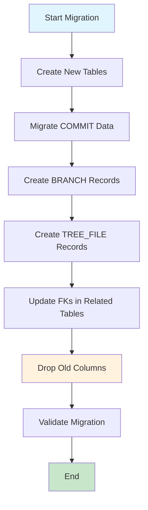
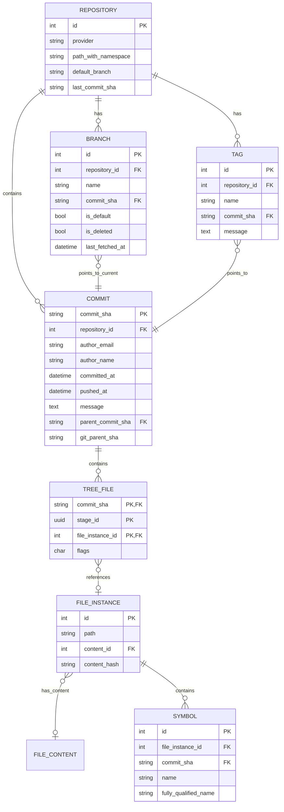

# Phase 2.5.1 Technical Design: COMMIT Entity and Tree-Based File Tracking

**Status**: `🧭` Design Complete  
**Created**: 2026-03-23  
**Phase**: 2.5.1 (Commit and Branch Schema)  
**Parent Plan**: [`multi_branch_tracking_implementation_plan.md`](./multi_branch_tracking_implementation_plan.md)  
**Baseline**: [`plans/multi_branch_brainstorm_baseline.md`](../../../plans/multi_branch_brainstorm_baseline.md)

---

## Executive Summary

This document provides the detailed technical design for Phase 2.5.1, which introduces:
1. A new **COMMIT** model with `commit_sha` as primary key (globally unique, repository-agnostic)
2. **BRANCH** and **TAG** models for branch-aware indexing
3. **TREE_FILE** junction table linking commits to file instances
4. Migration strategy from the current repository-scoped commit model

### Key Design Decisions

| Decision | Choice | Rationale |
|----------|--------|-----------|
| COMMIT PK | `commit_sha` (VARCHAR 40) | Globally unique, enables cross-repo sharing |
| COMMIT.repository_id | Removed | Commits are repository-agnostic |
| TREE_FILE PK | Composite (commit_sha, stage_id, file_instance_id) | Optimized storage, enforces exclusivity |
| Flags encoding | `"char"` (1 byte) with 4-bit masking | Most compact PostgreSQL storage, bits 4-7 reserved |
| Migration strategy | Create new tables, migrate data, update relationships | Zero data loss approach |

---

## 1. Schema Changes (SQLAlchemy Models)

### 1.1 COMMIT Model (Redesigned)

The existing [`Commit`](../../src/database/models.py:167) model uses an integer primary key and is repository-scoped. The new design uses `commit_sha` as the primary key and is repository-agnostic.

#### Current Schema (to be migrated)

```python
class Commit(Base):
    __tablename__ = "commits"
    
    id = Column(Integer, primary_key=True)
    repository_id = Column(Integer, ForeignKey("repositories.id"), nullable=False)
    sha = Column(String(40), nullable=False, unique=True)
    message = Column(Text)
    author_name = Column(String(255))
    author_email = Column(String(255))
    committed_date = Column(DateTime(timezone=True))
    parent_sha = Column(String(40))  # Git parent
```

#### New Schema

```python
class Commit(Base):
    """Repository-agnostic commit entity with delta compression support.
    
    Uses git SHA as primary key for cross-repo sharing.
    parent_commit_sha points to NEWER commit (replacement), not git parent.
    NULL parent_commit_sha indicates a snapshot (full TREE_FILE entries).
    """
    __tablename__ = "commits"
    
    commit_sha = Column(String(40), primary_key=True)
    repository_id = Column(Integer, ForeignKey("repositories.id", ondelete="CASCADE"), nullable=True, index=True)
    author_email = Column(String(255))
    author_name = Column(String(255))
    committed_at = Column(DateTime(timezone=True), index=True)
    pushed_at = Column(DateTime(timezone=True))
    message = Column(Text)
    parent_commit_sha = Column(String(40), ForeignKey("commits.commit_sha"), nullable=True, index=True)
    
    # Git metadata (informational only)
    git_parent_sha = Column(String(40))  # Actual git parent SHA
    
    created_at = Column(DateTime(timezone=True), default=utcnow, nullable=False)
    
    # Relationships
    repository = relationship("Repository", back_populates="commits")
    tree_files = relationship("TreeFile", back_populates="commit", cascade="all, delete-orphan")
    branches = relationship("Branch", back_populates="current_commit")
    tags = relationship("Tag", back_populates="commit")
    
    __table_args__ = (
        Index("idx_commits_parent", "parent_commit_sha", 
              postgresql_where="parent_commit_sha IS NOT NULL"),
        Index("idx_commits_repository_committed", "repository_id", "committed_at"),
    )
```

#### Field Notes

| Field | Type | Purpose |
|-------|------|---------|
| `commit_sha` | VARCHAR(40) PK | Git SHA-1 hash, globally unique |
| `repository_id` | FK (nullable) | First repo that indexed this commit; informational |
| `parent_commit_sha` | FK (nullable) | Points to NEWER commit for delta chain; NULL = snapshot |
| `git_parent_sha` | VARCHAR(40) | Actual git parent SHA (informational) |
| `pushed_at` | TIMESTAMP | When commit was pushed to remote (for sync tracking) |

---

### 1.2 BRANCH Model

```python
class Branch(Base):
    """First-class branch entity with mutable pointer to current commit."""
    __tablename__ = "branches"
    
    id = Column(Integer, primary_key=True)
    repository_id = Column(Integer, ForeignKey("repositories.id", ondelete="CASCADE"), nullable=False, index=True)
    name = Column(String(500), nullable=False)
    commit_sha = Column(String(40), ForeignKey("commits.commit_sha"), nullable=False, index=True)
    is_default = Column(Boolean, default=False, nullable=False)
    is_deleted = Column(Boolean, default=False, nullable=False)
    last_fetched_at = Column(DateTime(timezone=True))
    created_at = Column(DateTime(timezone=True), default=utcnow, nullable=False)
    updated_at = Column(DateTime(timezone=True), default=utcnow, onupdate=utcnow, nullable=False)
    
    # Relationships
    repository = relationship("Repository", back_populates="branches")
    current_commit = relationship("Commit", back_populates="branches")
    
    __table_args__ = (
        UniqueConstraint("repository_id", "name", name="uq_branches_repository_name"),
        Index("idx_branches_default", "repository_id", "is_default"),
    )
```

---

### 1.3 TAG Model

```python
class Tag(Base):
    """Immutable tag pointing to COMMIT."""
    __tablename__ = "tags"
    
    id = Column(Integer, primary_key=True)
    repository_id = Column(Integer, ForeignKey("repositories.id", ondelete="CASCADE"), nullable=False, index=True)
    name = Column(String(500), nullable=False)
    commit_sha = Column(String(40), ForeignKey("commits.commit_sha"), nullable=False, index=True)
    message = Column(Text, nullable=True)  # Annotated tags have messages
    tagger_name = Column(String(255))
    tagger_email = Column(String(255))
    created_at = Column(DateTime(timezone=True), default=utcnow, nullable=False)
    
    # Relationships
    repository = relationship("Repository", back_populates="tags")
    commit = relationship("Commit", back_populates="tags")
    
    __table_args__ = (
        UniqueConstraint("repository_id", "name", name="uq_tags_repository_name"),
    )
```

---

### 1.4 TREE_FILE Model

```python
from sqlalchemy.dialects.postgresql import CHAR as PG_CHAR

class TreeFile(Base):
    """Junction table linking COMMIT or LOCAL_STAGE to FILE_INSTANCE.
    
    Uses nullable FKs and composite PK for optimized storage.
    Exactly one of commit_sha or stage_id must be set (enforced by CHECK constraint).
    
    flags uses PostgreSQL internal "char" type (1 byte) with 4-bit encoding:
    - Bits 0-1: tree_type (file=1, symlink=2, submodule=3)
    - Bits 2-3: operation (base=0, add=1, modify=2, delete=3)
    - Bits 4-7: reserved for future use
    """
    __tablename__ = "tree_files"
    
    commit_sha = Column(String(40), ForeignKey("commits.commit_sha", ondelete="CASCADE"), nullable=True)
    stage_id = Column(UUID(as_uuid=True), ForeignKey("local_stages.id", ondelete="CASCADE"), nullable=True)
    file_instance_id = Column(Integer, ForeignKey("file_instances.id", ondelete="CASCADE"), nullable=True, index=True)
    flags = Column(PG_CHAR(1), default="\x00", nullable=False)  # PostgreSQL internal "char" (1 byte)
    
    # Relationships
    commit = relationship("Commit", back_populates="tree_files")
    file_instance = relationship("FileInstance")
    
    __table_args__ = (
        PrimaryKeyConstraint("commit_sha", "stage_id", "file_instance_id",
                             name="pk_tree_files"),
        CheckConstraint(
            "(commit_sha IS NOT NULL AND stage_id IS NULL) OR "
            "(commit_sha IS NULL AND stage_id IS NOT NULL)",
            name="ck_tree_files_exclusive_root"
        ),
        Index("idx_tree_files_commit", "commit_sha",
              postgresql_where="commit_sha IS NOT NULL"),
        Index("idx_tree_files_stage", "stage_id",
              postgresql_where="stage_id IS NOT NULL"),
    )
```

#### TREE_FILE Nullable FK Rationale

- `file_instance_id` is **nullable** to support:
  - DELETE operations that reference a tombstone or no instance
  - Future support for directory entries without file instances

- Exactly one of `commit_sha` or `stage_id` must be set (enforced by CHECK constraint)

---

## 2. Flag Encoding Design

### 2.1 Bit Layout

The `flags` field uses PostgreSQL's internal `"char"` type (1 byte) with compact 4-bit encoding:

```
Bits 0-1:   tree_type (file=1, symlink=2, submodule=3)
Bits 2-3:   operation (base=0, add=1, modify=2, delete=3)
Bits 4-7:   RESERVED for future use
```

This encoding uses only 4 bits of the available 8 bits, leaving 4 bits reserved for future extensions.

### 2.2 Python Constants

```python
# axon-src/src/config/tree_file_flags.py

from enum import IntEnum


class TreeType(IntEnum):
    """Encoded in bits 0-1 of TREE_FILE.flags
    
    Values use 2 bits (0-3 range).
    """
    FILE = 1       # Regular file
    SYMLINK = 2    # Symbolic link
    SUBMODULE = 3  # Git submodule reference


class Operation(IntEnum):
    """Encoded in bits 2-3 of TREE_FILE.flags
    
    Values use 2 bits (0-3 range), shifted by 2.
    """
    BASE = 0       # Part of base snapshot (no change)
    ADD = 1        # File added
    MODIFY = 2     # File modified
    DELETE = 3     # File deleted


# Bit masks and shifts (compact 4-bit encoding)
TREE_TYPE_MASK = 0x03    # Bits 0-1
OPERATION_MASK = 0x0C    # Bits 2-3
OPERATION_SHIFT = 2
RESERVED_MASK = 0xF0     # Bits 4-7 (reserved)


def encode_flags(tree_type: TreeType, operation: Operation) -> str:
    """Encode tree_type and operation into flags character.
    
    Returns a single character (1 byte) for PostgreSQL "char" type.
    """
    value = int(tree_type) | (int(operation) << OPERATION_SHIFT)
    return chr(value)


def decode_flags(flags: str) -> tuple[TreeType, Operation]:
    """Decode flags character into tree_type and operation."""
    value = ord(flags) if isinstance(flags, str) else flags
    tree_type = TreeType(value & TREE_TYPE_MASK)
    operation = Operation((value & OPERATION_MASK) >> OPERATION_SHIFT)
    return tree_type, operation


def is_delete(flags: str) -> bool:
    """Check if flags indicate a DELETE operation."""
    value = ord(flags) if isinstance(flags, str) else flags
    return ((value & OPERATION_MASK) >> OPERATION_SHIFT) == Operation.DELETE


def get_tree_type(flags: str) -> TreeType:
    """Extract tree_type from flags."""
    value = ord(flags) if isinstance(flags, str) else flags
    return TreeType(value & TREE_TYPE_MASK)


def get_operation(flags: str) -> Operation:
    """Extract operation from flags."""
    value = ord(flags) if isinstance(flags, str) else flags
    return Operation((value & OPERATION_MASK) >> OPERATION_SHIFT)


# Pre-computed common values as characters
FLAGS_FILE_BASE = encode_flags(TreeType.FILE, Operation.BASE)      # '\x00' (0)
FLAGS_FILE_ADD = encode_flags(TreeType.FILE, Operation.ADD)        # '\x05' (5)
FLAGS_FILE_MODIFY = encode_flags(TreeType.FILE, Operation.MODIFY)  # '\x09' (9)
FLAGS_FILE_DELETE = encode_flags(TreeType.FILE, Operation.DELETE)  # '\x0D' (13)
FLAGS_SYMLINK_BASE = encode_flags(TreeType.SYMLINK, Operation.BASE)  # '\x02' (2)
FLAGS_SUBMODULE_BASE = encode_flags(TreeType.SUBMODULE, Operation.BASE)  # '\x03' (3)
```

### 2.3 Example Values

| flags char | flags (dec) | binary | tree_type | operation | Description |
|------------|-------------|--------|-----------|-----------|-------------|
| `'\x00'` | 0 | `0000` | FILE | BASE | Commit snapshot file |
| `'\x05'` | 5 | `0101` | FILE | ADD | New file in stage |
| `'\x09'` | 9 | `1001` | FILE | MODIFY | Modified file in stage |
| `'\x0D'` | 13 | `1101` | FILE | DELETE | Deleted file (tombstone) |
| `'\x02'` | 2 | `0010` | SYMLINK | BASE | Symlink in commit |
| `'\x03'` | 3 | `0011` | SUBMODULE | BASE | Submodule reference |

### 2.4 Reserved Bits for Future Use

| Bits | Purpose (Future) | Status |
|------|------------------|--------|
| 4-5 | Merge conflict markers | Reserved |
| 6-7 | File permissions (executable bit) | Reserved |

---

## 3. Data Migration Strategy

### 3.1 Overview



### 3.2 Migration Steps

#### Step 1: Create New Tables

Create tables in order respecting FK constraints:
1. `commits` (new structure with commit_sha as PK)
2. `branches`
3. `tags`
4. `tree_files`

#### Step 2: Migrate COMMIT Data

```sql
-- Migrate existing commits to new structure
-- Note: This requires careful handling of the PK change

-- First, create new commit records
INSERT INTO commits_new (commit_sha, repository_id, author_email, author_name, 
                         committed_at, message, git_parent_sha, created_at)
SELECT 
    sha AS commit_sha,
    repository_id,
    author_email,
    author_name,
    committed_date AS committed_at,
    message,
    parent_sha AS git_parent_sha,
    created_at
FROM commits;

-- Handle duplicates (same SHA in multiple repos)
-- Keep first occurrence, update repository_id references
```

#### Step 3: Create BRANCH Records

```sql
-- Create default branch for each repository
INSERT INTO branches (repository_id, name, commit_sha, is_default, last_fetched_at)
SELECT 
    r.id AS repository_id,
    COALESCE(r.default_branch, 'main') AS name,
    r.last_commit_sha AS commit_sha,
    TRUE AS is_default,
    r.last_synced_at AS last_fetched_at
FROM repositories r
WHERE r.last_commit_sha IS NOT NULL;
```

#### Step 4: Create TREE_FILE Records

```sql
-- Link existing file_instances to commits via tree_files
-- flags = chr(tree_type | operation << 2) = chr(1 | 0 << 2) = chr(1) for FILE + BASE
INSERT INTO tree_files (commit_sha, stage_id, file_instance_id, flags)
SELECT
    c.sha AS commit_sha,
    NULL AS stage_id,
    fi.id AS file_instance_id,
    CHR(1) AS flags  -- FILE(1) + BASE(0) = chr(1)
FROM file_instances fi
JOIN commits c ON c.id = fi.commit_id
WHERE fi.commit_id IS NOT NULL;

-- For file_instances without commit_id, link to repository's last commit
INSERT INTO tree_files (commit_sha, stage_id, file_instance_id, flags)
SELECT
    r.last_commit_sha AS commit_sha,
    NULL AS stage_id,
    fi.id AS file_instance_id,
    CHR(1) AS flags  -- FILE(1) + BASE(0) = chr(1)
FROM file_instances fi
JOIN repositories r ON r.id = fi.repository_id
WHERE fi.commit_id IS NULL AND r.last_commit_sha IS NOT NULL;
```

#### Step 5: Update FK References

```sql
-- Update symbols.commit_id to reference commit_sha
-- This requires adding commit_sha column and populating it
ALTER TABLE symbols ADD COLUMN commit_sha VARCHAR(40);

UPDATE symbols s
SET commit_sha = c.sha
FROM commits c
WHERE c.id = s.commit_id;

-- Update file_instances.commit_id similarly
ALTER TABLE file_instances ADD COLUMN commit_sha VARCHAR(40);

UPDATE file_instances fi
SET commit_sha = c.sha
FROM commits c
WHERE c.id = fi.commit_id;
```

#### Step 6: Drop Old Columns

```sql
-- After validation, remove old columns
ALTER TABLE symbols DROP COLUMN commit_id;
ALTER TABLE file_instances DROP COLUMN commit_id;

-- Drop old commits table and rename new one
DROP TABLE commits;
ALTER TABLE commits_new RENAME TO commits;
```

### 3.3 Rollback Strategy

```sql
-- Rollback: Restore from backup
-- 1. Restore old commits table from pre-migration backup
-- 2. Drop new tables (branches, tags, tree_files)
-- 3. Restore old FK columns

-- Full database restore from backup is the safest rollback
-- pg_restore -d indexer indexer_backup.dump
```

---

## 4. Alembic Migration Script Outline

### 4.1 Migration File Structure

```
axon-src/src/database/migrations/versions/
└── a1b2c3d4e5f6_phase_251_commit_branch_schema.py
```

### 4.2 Migration Pseudocode

```python
"""Phase 2.5.1: Commit and Branch Schema

Revision ID: a1b2c3d4e5f6
Revises: cd4ad910d3fe
Create Date: 2026-03-23

"""
from alembic import op
import sqlalchemy as sa
from sqlalchemy.dialects import postgresql

revision = "a1b2c3d4e5f6"
down_revision = "cd4ad910d3fe"
branch_labels = None
depends_on = None


def upgrade() -> None:
    # === PHASE 1: Create new tables ===
    
    # 1. Create new commits table with commit_sha as PK
    op.create_table(
        "commits_new",
        sa.Column("commit_sha", sa.String(40), primary_key=True),
        sa.Column("repository_id", sa.Integer(), sa.ForeignKey("repositories.id", ondelete="CASCADE"), nullable=True),
        sa.Column("author_email", sa.String(255)),
        sa.Column("author_name", sa.String(255)),
        sa.Column("committed_at", sa.DateTime(timezone=True)),
        sa.Column("pushed_at", sa.DateTime(timezone=True)),
        sa.Column("message", sa.Text()),
        sa.Column("parent_commit_sha", sa.String(40), sa.ForeignKey("commits_new.commit_sha"), nullable=True),
        sa.Column("git_parent_sha", sa.String(40)),
        sa.Column("created_at", sa.DateTime(timezone=True), nullable=False),
    )
    op.create_index("idx_commits_parent", "commits_new", ["parent_commit_sha"],
                    postgresql_where="parent_commit_sha IS NOT NULL")
    op.create_index("idx_commits_repository_committed", "commits_new", ["repository_id", "committed_at"])
    
    # 2. Create branches table
    op.create_table(
        "branches",
        sa.Column("id", sa.Integer(), primary_key=True),
        sa.Column("repository_id", sa.Integer(), sa.ForeignKey("repositories.id", ondelete="CASCADE"), nullable=False),
        sa.Column("name", sa.String(500), nullable=False),
        sa.Column("commit_sha", sa.String(40), sa.ForeignKey("commits_new.commit_sha"), nullable=False),
        sa.Column("is_default", sa.Boolean(), default=False, nullable=False),
        sa.Column("is_deleted", sa.Boolean(), default=False, nullable=False),
        sa.Column("last_fetched_at", sa.DateTime(timezone=True)),
        sa.Column("created_at", sa.DateTime(timezone=True), nullable=False),
        sa.Column("updated_at", sa.DateTime(timezone=True), nullable=False),
        sa.UniqueConstraint("repository_id", "name", name="uq_branches_repository_name"),
    )
    op.create_index("idx_branches_repo", "branches", ["repository_id"])
    op.create_index("idx_branches_commit", "branches", ["commit_sha"])
    op.create_index("idx_branches_default", "branches", ["repository_id", "is_default"])
    
    # 3. Create tags table
    op.create_table(
        "tags",
        sa.Column("id", sa.Integer(), primary_key=True),
        sa.Column("repository_id", sa.Integer(), sa.ForeignKey("repositories.id", ondelete="CASCADE"), nullable=False),
        sa.Column("name", sa.String(500), nullable=False),
        sa.Column("commit_sha", sa.String(40), sa.ForeignKey("commits_new.commit_sha"), nullable=False),
        sa.Column("message", sa.Text()),
        sa.Column("tagger_name", sa.String(255)),
        sa.Column("tagger_email", sa.String(255)),
        sa.Column("created_at", sa.DateTime(timezone=True), nullable=False),
        sa.UniqueConstraint("repository_id", "name", name="uq_tags_repository_name"),
    )
    op.create_index("idx_tags_repo", "tags", ["repository_id"])
    op.create_index("idx_tags_commit", "tags", ["commit_sha"])
    
    # 4. Create tree_files table
    # Note: flags uses PostgreSQL internal "char" type (1 byte)
    # Values: chr(tree_type | operation << 2) where tree_type in 1-3, operation in 0-3
    op.execute("""
        CREATE TABLE tree_files (
            commit_sha VARCHAR(40) REFERENCES commits_new(commit_sha) ON DELETE CASCADE,
            stage_id UUID,  -- FK added in Phase 2.5.4
            file_instance_id INTEGER REFERENCES file_instances(id) ON DELETE CASCADE,
            flags "char" NOT NULL DEFAULT '\\x00',
            PRIMARY KEY (commit_sha, stage_id, file_instance_id),
            CONSTRAINT ck_tree_files_exclusive_root CHECK (
                (commit_sha IS NOT NULL AND stage_id IS NULL) OR
                (commit_sha IS NULL AND stage_id IS NOT NULL)
            )
        )
    """)
    op.create_index("idx_tree_files_instance", "tree_files", ["file_instance_id"])
    op.create_index("idx_tree_files_commit", "tree_files", ["commit_sha"],
                    postgresql_where="commit_sha IS NOT NULL")
    
    # === PHASE 2: Migrate data ===
    
    # Migrate commits (handle duplicates by keeping first occurrence)
    op.execute("""
        INSERT INTO commits_new (commit_sha, repository_id, author_email, author_name,
                                 committed_at, message, git_parent_sha, created_at)
        SELECT DISTINCT ON (sha)
            sha AS commit_sha,
            repository_id,
            author_email,
            author_name,
            committed_date AS committed_at,
            message,
            parent_sha AS git_parent_sha,
            created_at
        FROM commits
        ORDER BY sha, id
    """)
    
    # Create default branches
    op.execute("""
        INSERT INTO branches (repository_id, name, commit_sha, is_default, last_fetched_at, 
                              created_at, updated_at)
        SELECT 
            r.id,
            COALESCE(r.default_branch, 'main') AS name,
            r.last_commit_sha AS commit_sha,
            TRUE AS is_default,
            r.last_synced_at AS last_fetched_at,
            NOW() AS created_at,
            NOW() AS updated_at
        FROM repositories r
        WHERE r.last_commit_sha IS NOT NULL
    """)
    
    # Create tree_files from existing file_instances
    # flags = chr(tree_type | operation << 2) = chr(1 | 0 << 2) = chr(1) for FILE + BASE
    op.execute("""
        INSERT INTO tree_files (commit_sha, stage_id, file_instance_id, flags)
        SELECT
            c.sha AS commit_sha,
            NULL AS stage_id,
            fi.id AS file_instance_id,
            CHR(1) AS flags  -- FILE(1) + BASE(0) = chr(1)
        FROM file_instances fi
        JOIN commits c ON c.id = fi.commit_id
        WHERE fi.commit_id IS NOT NULL
    """)
    
    # Link file_instances without commit_id to repository's last commit
    op.execute("""
        INSERT INTO tree_files (commit_sha, stage_id, file_instance_id, flags)
        SELECT
            r.last_commit_sha AS commit_sha,
            NULL AS stage_id,
            fi.id AS file_instance_id,
            CHR(1) AS flags  -- FILE(1) + BASE(0) = chr(1)
        FROM file_instances fi
        JOIN repositories r ON r.id = fi.repository_id
        WHERE fi.commit_id IS NULL
          AND r.last_commit_sha IS NOT NULL
          AND NOT EXISTS (
              SELECT 1 FROM tree_files tf WHERE tf.file_instance_id = fi.id
          )
    """)
    
    # === PHASE 3: Update relationships ===
    
    # Add commit_sha columns to related tables
    op.add_column("symbols", sa.Column("commit_sha", sa.String(40), nullable=True))
    op.add_column("file_instances", sa.Column("commit_sha_new", sa.String(40), nullable=True))
    
    # Populate new FK columns
    op.execute("""
        UPDATE symbols s
        SET commit_sha = c.sha
        FROM commits c
        WHERE c.id = s.commit_id
    """)
    
    op.execute("""
        UPDATE file_instances fi
        SET commit_sha_new = c.sha
        FROM commits c
        WHERE c.id = fi.commit_id
    """)
    
    # Create indexes on new columns
    op.create_index("ix_symbols_commit_sha", "symbols", ["commit_sha"])
    op.create_index("ix_file_instances_commit_sha", "file_instances", ["commit_sha_new"])
    
    # === PHASE 4: Switch to new schema ===
    
    # Drop old FK constraints
    op.drop_constraint("symbols_commit_id_fkey", "symbols", type_="foreignkey")
    op.drop_constraint("file_instances_commit_id_fkey", "file_instances", type_="foreignkey")
    
    # Drop old columns (after validation in production)
    # These are commented out for safety - run manually after validation
    # op.drop_column("symbols", "commit_id")
    # op.drop_column("file_instances", "commit_id")
    
    # Rename commits table
    # op.drop_table("commits")
    # op.rename_table("commits_new", "commits")


def downgrade() -> None:
    # Reverse the migration
    # Note: Full downgrade requires database restore from backup
    
    # Drop new tables
    op.drop_table("tree_files")
    op.drop_table("tags")
    op.drop_table("branches")
    op.drop_table("commits_new")
    
    # Drop new columns
    op.drop_column("symbols", "commit_sha")
    op.drop_column("file_instances", "commit_sha_new")
```

---

## 5. API Impact Analysis

### 5.1 Endpoints Requiring Updates

| Endpoint | Current Behavior | Required Change |
|----------|------------------|-----------------|
| `POST /repositories/{id}/sync` | Creates Commit records | Create Commit with commit_sha PK, create/update Branch |
| `GET /repositories/{id}` | Returns last_commit_sha | Add branch info, current branch name |
| `GET /files/{file_id}` | Returns file with commit_id | Return commit_sha instead |
| `GET /symbols` | Filter by commit_id | Support commit_sha filter |
| `GET /search` | Repository-scoped search | Support branch/commit scoping |

### 5.2 New Endpoints Required

| Endpoint | Purpose |
|----------|---------|
| `GET /repositories/{id}/branches` | List all branches |
| `GET /repositories/{id}/branches/{name}` | Get branch details |
| `GET /repositories/{id}/tags` | List all tags |
| `GET /commits/{sha}` | Get commit details |
| `GET /commits/{sha}/files` | List files in commit |

### 5.3 Files Requiring Modification

```
axon-src/src/api/routes/repositories.py
  - trigger_sync(): Update to create Branch records
  
axon-src/src/api/routes/symbols.py
  - list_symbols(): Add commit_sha filter support

axon-src/src/api/services/repository_service.py
  - trigger_sync(): Update commit creation logic

axon-src/src/api/services/search_service.py
  - search(): Add branch/commit scoping

axon-src/src/workers/repository_sync_worker.py
  - Update commit/branch creation during sync

axon-src/src/workers/file_worker.py
  - Update file_instance to commit linking
```

### 5.4 Response Schema Changes

#### RepositoryResponse (additions)

```python
class RepositoryResponse(BaseModel):
    # ... existing fields ...
    
    # New fields
    current_branch: Optional[str] = None
    branch_count: int = 0
    tag_count: int = 0
```

#### SymbolResponse (changes)

```python
class SymbolResponse(BaseModel):
    # ... existing fields ...
    
    # Changed from commit_id to commit_sha
    commit_sha: Optional[str] = None  # Was: commit_id: Optional[int]
```

---

## 6. Implementation Checklist

### Phase 2.5.1 Implementation Steps

- [ ] **Step 1**: Create flag encoding module (`tree_file_flags.py`)
- [ ] **Step 2**: Create new SQLAlchemy models (Commit, Branch, Tag, TreeFile)
- [ ] **Step 3**: Update Repository model with new relationships
- [ ] **Step 4**: Create Alembic migration script
- [ ] **Step 5**: Test migration on baseline data copy
- [ ] **Step 6**: Update API response schemas
- [ ] **Step 7**: Update sync worker to create Branch records
- [ ] **Step 8**: Add new API endpoints for branches/tags
- [ ] **Step 9**: Update search service for branch scoping
- [ ] **Step 10**: Integration testing with baseline data

---

## 7. Open Questions

### Questions Requiring User Input Before Implementation

1. **Migration Timing**: Should the migration support online operation (with application running) or require a maintenance window?

2. **Old Column Cleanup**: Should we drop `commit_id` columns immediately after migration or keep them for a transition period?

3. **Default Branch Detection**: How should we handle repositories where `default_branch` is NULL? Auto-detect from remote or assume 'main'?

4. **Commit SHA Display**: For cross-repo commits, which repository_id should be displayed? First to index, or all?

5. **API Versioning**: Should we version the API changes (e.g., `/v2/repositories`) or update in-place?

---

## 8. Related Documentation

- [Multi-Branch Tracking Implementation Plan](./multi_branch_tracking_implementation_plan.md)
- [Multi-Branch Brainstorm Baseline](../../../plans/multi_branch_brainstorm_baseline.md)
- [Existing Database Models](../../src/database/models.py)
- [Baseline Schema Migration](../../src/database/migrations/versions/cd4ad910d3fe_baseline_schema.py)
- [Phase 2.5.0 Completion Summary](../validation/phase_2.5.0_completion_summary.md)

---

## Appendix A: ER Diagram



---

## Appendix B: Storage Estimates

Based on Phase 2.5.0 baseline data:

| Repository | Files | Symbols | Chunks | Est. TREE_FILE Rows |
|------------|-------|---------|--------|---------------------|
| workspace-axon-mcp | 11 | 219 | 421 | 11 |
| jverein | 826 | 8,626 | 9,432 | 826 |
| **Total** | **837** | **8,845** | **9,853** | **837** |

### TREE_FILE Storage Calculation

- Row size: ~23 bytes (commit_sha: 40, stage_id: 16, file_instance_id: 4, flags: 1)
- Per commit: 837 files × 23 bytes ≈ 19 KB
- 100 commits: ~1.9 MB (without delta compression)
- With delta compression (80% reduction): ~380 KB

Note: `flags` uses PostgreSQL internal `"char"` type (1 byte) instead of SMALLINT (2 bytes).

---

*Document generated: 2026-03-23*
*Author: Architect Mode*
*Status: Ready for Review*
